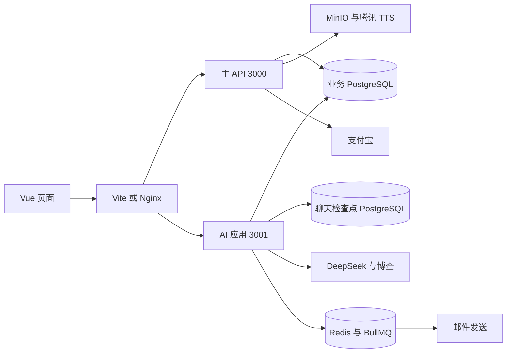

# English AI 项目总体架构

English AI 将单词学习、课程购买、AI 对话和学习提醒放在同一产品内。复习时先串起用户操作，再看框架如何承接业务。本文以 2026-10-25 的仓库源码为准。

## 项目如何拆分

| 目录 | 职责 | 关键知识 |
| --- | --- | --- |
| apps/web | Vue 3 页面、路由、状态、网络请求 | 响应式、组件生命周期、异步竞态 |
| apps/tracker | 独立埋点 SDK | 库构建、浏览器事件、访客身份切换 |
| packages/common | 前后端共享类型及 Agent 配色 | workspace 依赖、编译期契约 |
| packages/config | 开发端口等配置 | 避免各应用重复定义常量 |
| server/apps/server | 用户、学习、课程、支付、埋点 | NestJS 模块、鉴权、数据库事务 |
| server/apps/ai | 对话、人物设定、日报任务 | SSE、模型调用、检查点、队列 |
| server/libs/shared | 数据库、JWT、存储、邮件和账号锁 | 依赖注入与基础设施复用 |
| deploy | 镜像、编排、反向代理、发布 | 健康检查、迁移、子路径部署 |

顶层是 pnpm workspace，后端内部是 Nest CLI 管理的多应用项目。主 API 与 AI 是两个进程，通过 HTTP 触发重排任务，复用共享库与业务库；称为“双后端应用”更准确，不能据此声称已具备服务注册、链路追踪或完整微服务治理。`@Global` 也只对各自 Nest 应用容器生效，不是跨进程单例。

## 一次操作经过哪些层



开发入口为 web 8080、server 3000、ai 3001。业务 URL 是 `/api/v1`，AI URL 是 `/ai/v1`；生产页面可挂在 `/english/`，API 仍使用根路径。部署不能把所有资源统一机械地加上 `/english`。

## 技术栈与版本口径

依赖声明包括 Vue 3.5、Vue Router 5、Pinia 3、web 的 Vite 7、tracker 的 Vite 8、Tailwind CSS 4、NestJS core 10、Prisma 7、BullMQ 5、LangChain 1。部分 Nest 配套包声明为 11，不能说全部 Nest 包都为 10。版本区间来自 package.json，实际解析版本以 pnpm-lock.yaml 为准。

业务 Prisma schema 有 **13 个模型、1 个枚举**。聊天检查点由 PostgresSaver 在 `AI_DATABASE_URL` 对应库初始化，不计入这 13 个业务模型。

## 本地启动与复习顺序

```bash
pnpm install --frozen-lockfile
pnpm --filter @en/tracker build
pnpm --filter @en/server exec prisma generate
pnpm all
```

以上命令在项目根目录执行；先按项目 README 配好 PostgreSQL、Redis、MinIO 和后端环境变量。`pnpm all` 只启动三个开发应用，不会自动启动基础设施或完成数据导入。tracker 是构建产物依赖，首次运行先构建它。

建议按“架构 → 用户与 JWT → 学习和数据库 → 支付 → AI → 队列 → 前端竞态 → 部署 → 面试”阅读。每一条简历能力都应能指向具体业务链路和验证用例。

## 源码定位

- [package.json](<../package.json>)
- [pnpm-workspace.yaml](<../pnpm-workspace.yaml>)
- [server/nest-cli.json](<../server/nest-cli.json>)
- [apps/web/package.json](<../apps/web/package.json>)
- [server/package.json](<../server/package.json>)
- [packages/config/index.ts](<../packages/config/index.ts>)
- [server/prisma/schema.prisma](<../server/prisma/schema.prisma>)
- [deploy/compose.yaml](<../deploy/compose.yaml>)
